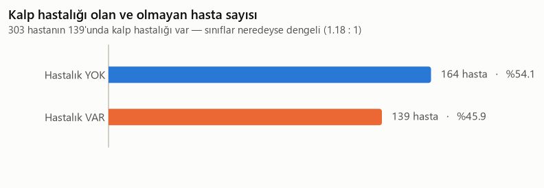
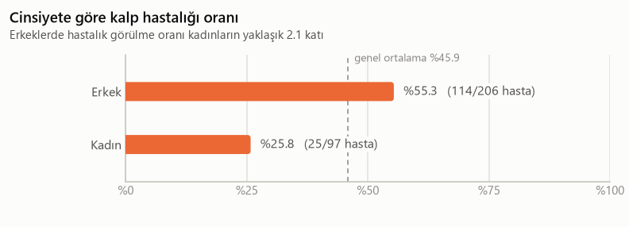
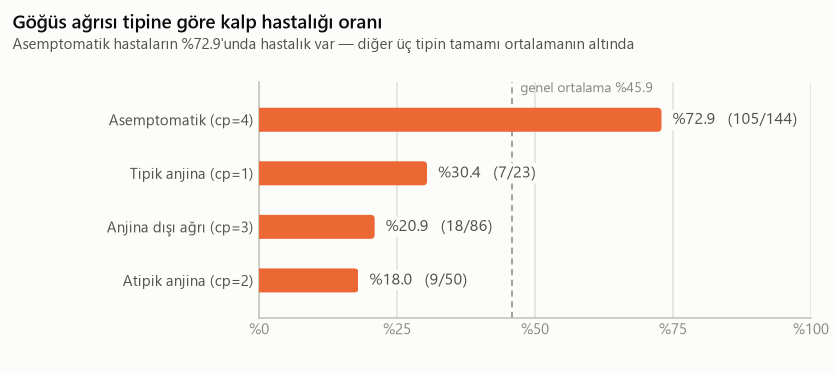
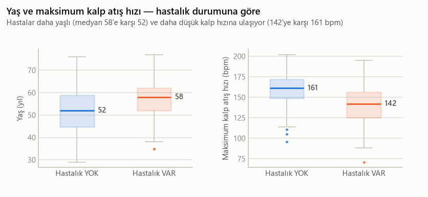
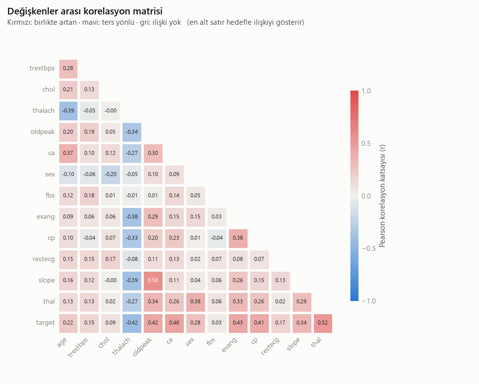
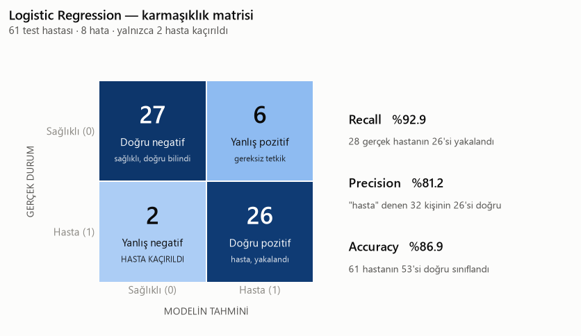

<div align="center">

# ❤️ Kalp Hastalığı Tahmini

**Klinik ölçümlerden kalp hastalığı riskini tahmin eden uçtan uca makine öğrenmesi projesi**

Veri temizlemeden model eğitimine, hata analizinden canlı web arayüzüne kadar
tüm adımları içerir.


</div>

---

## 📋 İçindekiler

- [Proje Ne Yapıyor?](#-proje-ne-yapıyor)
- [Kullanılan Veri Seti](#-kullanılan-veri-seti)
- [Nasıl Çalıştırılır?](#-nasıl-çalıştırılır)
- [Sonuçlar ve Analiz](#-sonuçlar-ve-analiz)
- [Ekran Görüntüleri](#-ekran-görüntüleri)
- [Proje Dosya Yapısı](#-proje-dosya-yapısı)
- [Bilinen Sınırlılıklar](#-bilinen-sınırlılıklar)

---

## 🎯 Proje Ne Yapıyor?

Bu proje, bir hastanın **yaş, cinsiyet, kan basıncı, kolesterol, egzersiz testi ve
görüntüleme bulguları** gibi 13 klinik ölçümünü kullanarak o kişide **kalp hastalığı
olup olmadığını** tahmin eden ikili bir sınıflandırma modeli geliştirir.

### Amaç

Kalp-damar hastalıkları dünyada en sık ölüm nedenidir ve erken teşhis hayat kurtarır.
Kesin teşhis **anjiyografi** ile konur; ancak bu işlem invaziv, pahalı ve her hastaya
uygulanamayacak bir yöntemdir. Bu projenin amacı, rutin test sonuçlarından yola çıkarak
**hangi hastaların ileri tetkike yönlendirilmesi gerektiğini** önceliklendiren bir
*tarama* modeli kurmaktır.

> ⚠️ Bu bir **eğitim projesidir, tıbbi teşhis aracı değildir.** Üretilen sonuçlar
> klinik karar için kullanılamaz.

### Proje adımları

| # | Aşama | İçerik |
|---|---|---|
| 1 | **Veri hazırlama** | Yükleme, sütunların tıbbi anlamı, sınıf dengesi analizi |
| 2 | **Veri temizleme** | Eksik değer tespiti ve mod ile doldurma |
| 3 | **Özellik mühendisliği** | Kategorik değişkenlerin One-Hot Encoding ile sayısallaştırılması |
| 4 | **Görselleştirme** | 6 grafikle keşifsel veri analizi (EDA) ve yorumlanması |
| 5 | **Modelleme** | Logistic Regression, Decision Tree ve Random Forest karşılaştırması |
| 6 | **Değerlendirme** | Accuracy / Precision / Recall, çapraz doğrulama, karmaşıklık matrisi |
| 7 | **Hata analizi** | Yanlış tahmin edilen hastaların tek tek incelenmesi |
| 8 | **Dağıtım** | Modelin kaydedilmesi ve Streamlit web arayüzü |

---

## 📊 Kullanılan Veri Seti

**Heart Disease UCI** — Cleveland Clinic Foundation tarafından toplanan, literatürde en
çok kullanılan kalp hastalığı veri setidir.

| Özellik | Değer |
|---|---|
| Kayıt sayısı | **303 hasta** |
| Sütun sayısı | **14** (13 özellik + 1 hedef) |
| Eksik değer | 6 kayıt (`ca` sütununda 4, `thal` sütununda 2) |
| Hedef dağılımı | 164 sağlıklı (%54.1) / 139 hastalıklı (%45.9) — **dengeli** |

### 🔗 Veri seti bağlantıları

| Kaynak | Bağlantı |
|---|---|
| **Kaggle** (Cleveland, 303 kayıt) | https://www.kaggle.com/datasets/cherngs/heart-disease-cleveland-uci |
| **Kaggle** (4 merkez birleşik, 920 kayıt) | https://www.kaggle.com/datasets/redwankarimsony/heart-disease-data |
| **UCI Machine Learning Repository** (projenin kullandığı asıl kaynak) | https://archive.ics.uci.edu/dataset/45/heart+disease |

> 📌 **Önemli not:** Bu proje veriyi doğrudan **UCI arşivinden** (`processed.cleveland.data`)
> indirir ve **orijinal kodlamayı** kullanır (`cp`: 1–4, `thal`: 3/6/7). Kaggle'daki bazı
> türevlerde bu kodlar sıfırdan başlayacak şekilde yeniden numaralandırılmıştır. Kaggle
> sürümünü kullanacaksanız kodlamaları kontrol edin.
>
> Ayrıca, kaynaklarda sıkça atıf yapılan `kaggle.com/datasets/ronitf/heart-disease-uci`
> bağlantısı **artık yayından kaldırılmıştır** (404); yukarıdaki bağlantılar günceldir.

### Sütunların anlamı

| Sütun | Anlamı | Değerler |
|---|---|---|
| `age` | Yaş | 29 – 77 |
| `sex` | Cinsiyet | 1 = erkek, 0 = kadın |
| `cp` | Göğüs ağrısı tipi | 1 = tipik anjina, 2 = atipik anjina, 3 = anjina dışı, 4 = asemptomatik |
| `trestbps` | Dinlenme kan basıncı (mm Hg) | 94 – 200 |
| `chol` | Serum kolesterol (mg/dl) | 126 – 564 |
| `fbs` | Açlık kan şekeri > 120 mg/dl | 1 = evet, 0 = hayır |
| `restecg` | Dinlenme EKG sonucu | 0 = normal, 1 = ST-T anormalliği, 2 = sol ventrikül hipertrofisi |
| `thalach` | Egzersizde ulaşılan maksimum kalp hızı | 71 – 202 |
| `exang` | Egzersize bağlı anjina | 1 = var, 0 = yok |
| `oldpeak` | Egzersizin oluşturduğu ST çökmesi | 0.0 – 6.2 |
| `slope` | Egzersiz ST segmentinin eğimi | 1 = yukarı, 2 = düz, 3 = aşağı |
| `ca` | Floroskopide boyanan ana damar sayısı | 0 – 3 |
| `thal` | Talyum stres testi | 3 = normal, 6 = sabit defekt, 7 = geri dönüşlü defekt |
| `num` | **Hedef** — kalp hastalığı tanısı | 0 = yok, 1–4 = var |

---

## 🚀 Nasıl Çalıştırılır?

### Ön koşullar

- **Python 3.10 veya üzeri** (proje 3.13.17 ile test edilmiştir)
- `git` (depoyu klonlamak için)

### 1. Depoyu klonlayın

```bash
git clone https://github.com/KULLANICI_ADINIZ/DEPO_ADINIZ.git
cd DEPO_ADINIZ
```

### 2. Sanal ortam oluşturun (önerilir)

```bash
python -m venv venv
```

```bash
# Windows
venv\Scripts\activate

# macOS / Linux
source venv/bin/activate
```

### 3. Bağımlılıkları kurun

> ⚠️ **Windows kullanıcıları için önemli:** Kurulumda `pip install` yerine
> **`python -m pip install`** komutunu kullanın. Windows'un **Device Guard /
> Smart App Control** politikası, imzasız `pip.exe` ara çalıştırıcısını
> engelleyebilir; `python -m pip` biçimi bu sorunu yaşamaz.

```bash
python -m pip install -r requirements.txt
```

### 4. Web arayüzünü başlatın

```bash
streamlit run app.py
```

Komut çalıştıktan sonra arayüz tarayıcıda otomatik açılır. Açılmazsa
**http://localhost:8501** adresine gidin.

Formu doldurup **"Tahmin Et"** butonuna bastığınızda model sonucu
*"Kalp Hastalığı Riski Yüksek"* veya *"Düşük Risk — Sağlıklı"* olarak gösterir.

---

### 📖 Kodlar nasıl incelenir?

#### `analysis.ipynb` — analiz ve modelleme defteri

Projenin tüm analizi bu dosyadadır: veri temizleme, 6 grafik, model karşılaştırması ve
hata analizi. **Çıktılarıyla birlikte kaydedilmiştir**, bu yüzden çalıştırmadan da
okunabilir:

- **GitHub üzerinden:** Depodaki `analysis.ipynb` dosyasına tıklamanız yeterlidir;
  GitHub notebook'ları grafikleriyle birlikte otomatik görüntüler.
- **VS Code ile:** Dosyayı açın, sağ üstten çekirdek (kernel) olarak projenin sanal
  ortamını seçin ve `Run All` deyin.
- **Jupyter ile:**

```bash
python -m pip install notebook
jupyter notebook analysis.ipynb
```

#### `app.py` — Streamlit arayüzü

Arayüz kodu tek dosyadadır ve bölümlere ayrılmıştır: sabitler → model yükleme →
yardımcı fonksiyonlar → giriş formu → tahmin. Herhangi bir metin düzenleyicide
okunabilir. Modeli **eğitmez**, yalnızca `model/kalp_modeli.pkl` dosyasını okur.

#### Modeli yeniden üretmek

`model/kalp_modeli.pkl` dosyası depoya dahildir, dolayısıyla arayüz doğrudan çalışır.
Modeli sıfırdan eğitmek isterseniz `analysis.ipynb` dosyasını baştan sona çalıştırın;
10. bölüm model dosyasını yeniden oluşturur.

---

## 📈 Sonuçlar ve Analiz

### Model karşılaştırması

Veri **%80 eğitim / %20 test** olarak bölündü (`stratify=y`, `random_state=42`) →
242 eğitim / 61 test hastası.

| Model | Accuracy | Precision | Recall | Eğitim doğruluğu | CV Accuracy (5 kat) |
|---|---|---|---|---|---|
| 🥇 **Logistic Regression** | **%86.89** | **%81.25** | **%92.86** | %85.95 | **%84.81 ± 3.84** |
| 🥈 Random Forest | %86.89 | %81.25 | %92.86 | %100 | %82.51 ± 2.18 |
| 🥉 Decision Tree | %78.69 | %71.43 | %89.29 | %100 | %77.19 ± 6.10 |

### Neden Logistic Regression seçildi?

1. **Çapraz doğrulamada en iyi.** Test kümesinde Logistic Regression ve Random Forest
   birebir aynı sonucu verdi — 61 kişilik bir test kümesi iki modeli ayırmaya yetmiyor
   (tek hasta %1.6 puan oynatır). 303 hastanın tamamını kullanan 5 katlı çapraz
   doğrulama ikisini ayırdı: **%84.81'e karşı %82.51**.
2. **Aşırı öğrenme yok.** Eğitim (%85.95) ve test (%86.89) doğrulukları birbirine yakın.
   Buna karşılık Decision Tree eğitimde %100 yapıp testte %78.69'a düşüyor — klasik
   *overfitting*. (Random Forest de eğitimde %100 yapar, ancak 300 ağacın oyu ezberin
   rastgele kısmını temizlediği için genellemesi iyidir.)
3. **Yorumlanabilir.** Her değişkenin katsayısı, riski hangi yönde ve ne kadar
   etkilediğini doğrudan söyler. Tıbbi bir karar destek aracında bu şeffaflık birkaç
   puanlık başarımdan değerlidir.

### Keşifsel analizin öne çıkan bulguları

| Bulgu | Değer |
|---|---|
| Erkeklerde hastalık oranı | **%55.3** (114/206) — kadınların (%25.8) **2.1 katı** |
| Asemptomatik göğüs ağrısı grubunda oran | **%72.9** (105/144) — en güçlü tek ayırıcı |
| Hastaların maks. kalp hızı medyanı | **142 bpm** (sağlıklılarda 161 bpm) |
| Hedefle en güçlü korelasyonlar | `thal` +0.52 · `ca` +0.46 · `exang` +0.43 · `thalach` −0.42 |
| Hedefle ilişkisiz çıkanlar | `chol` +0.09 · `fbs` +0.03 |

---

### 🩺 Kritik analiz: Neden "Yanlış Hayır" çok daha tehlikeli?

Bir tıbbi modelde iki hata türü **asla eşdeğer değildir**:

| | **Yanlış Negatif (FN)** | **Yanlış Pozitif (FP)** |
|---|---|---|
| **Ne oldu?** | Kalp hastası olan kişiye "sağlıklısın" dendi | Sağlıklı kişiye "hasta olabilirsin" dendi |
| **Hastaya ne olur?** | Eve gönderilir, tedavi başlamaz | İleri tetkike yönlendirilir |
| **Sonucu** | Tedavi edilmemiş koroner arter hastalığı: **miyokart enfarktüsü, ani kardiyak ölüm** | Kaygı, zaman ve para kaybı, küçük işlem riski |
| **Geri dönüşü var mı?** | ❌ **Yok** — kalp krizinde oluşan doku hasarı kalıcıdır | ✅ **Var** — ileri tetkik hatayı ortaya çıkarır |

#### Asıl gerekçe: hatanın geri döndürülebilirliği

İki hata da maliyetlidir, ancak **maliyetleri aynı türden değildir**:

- **Yanlış pozitifin maliyetini bir sonraki adım düzeltir.** Sağlıklı birine "hasta
  olabilir" dediğinizde o kişi anjiyografiye gider ve damarlarının temiz olduğu görülür.
  **Sistem kendi hatasını yakalar.**
- **Yanlış negatifin maliyetini düzeltecek bir sonraki adım yoktur.** Hasta birine
  "sağlıklısın" dediğinizde o kişi sistemden çıkar. Hata çoğu zaman hastanın acil servise
  kalp kriziyle gelmesiyle ortaya çıkar; o noktada kaybedilen kalp kası geri gelmez.

Bu yüzden tarama modellerinde öncelikli metrik **recall (duyarlılık)**'tir. Model
**teşhis koymaz**; yalnızca "bu kişiye daha yakından bakılsın" der. Kesin teşhisi
anjiyografi koyar. Dolayısıyla modelin işi şüphelileri elemek değil,
**şüphelileri kaçırmamaktır**.

#### Modelimizin bu konudaki başarımı

Seçilen modelin 61 test hastası üzerindeki karmaşıklık matrisi:

| | Tahmin: Sağlıklı | Tahmin: Hasta |
|---|---|---|
| **Gerçek: Sağlıklı** | ✅ 27 (doğru negatif) | ⚠️ **6** (yanlış pozitif) |
| **Gerçek: Hasta** | 🚨 **2** (yanlış negatif) | ✅ 26 (doğru pozitif) |

Model **28 gerçek hastanın 26'sını yakaladı, yalnızca 2'sini kaçırdı** (recall %92.86).
Karşılığında 6 sağlıklı kişiye gereksiz yere "hasta" dedi (precision %81.25).
**Bu takas bilinçli olarak doğru taraftadır:** 6 kişinin ek tetkike gitmesi, 1 hastanın
fazladan kaçırılmasından iyidir.

#### Peki neden "herkese hasta de" denmiyor?

Karar eşiği sıfıra çekilirse recall %100 olur — hiç hasta kaçırılmaz. Ancak o noktada
precision veri setindeki hasta oranına (%45.9) düşer ve model **hiçbir bilgi üretmemiş**
olur. Dahası, gereksiz invaziv işlemler gerçek zarar verir ve aşırı yanlış alarm
klinisyenin uyarıları ciddiye almayı bırakmasına yol açar (*alarm yorgunluğu*).

Doğru hedef FN'i sıfırlamak değil, **FN'e FP'den çok daha ağır bir ceza vererek dengeyi
kurmaktır.** Pratik yöntemler: karar eşiğini düşürmek, `class_weight={0:1, 1:3}`
kullanmak veya modeli F1 yerine **F2 skoru** ile optimize etmek.

---

## 📸 Ekran Görüntüleri

### Streamlit web arayüzü

<!-- Arayüzü `streamlit run app.py` ile açıp ekran görüntüsü alın,
     görselleri docs/ klasörüne koyun ve aşağıdaki bağlantıları güncelleyin.
     GitHub'da bir Issue'ya sürükleyip bırakarak da bağlantı üretebilirsiniz. -->


> *Kullanıcının yaş, cinsiyet, göğüs ağrısı tipi, kan basıncı ve kolesterol gibi
> bilgileri girdiği form.*


> *"Tahmin Et" butonuna basıldığında görünen sonuç kartı, olasılık ölçeri ve
> "Model bu kararı neden verdi?" döküm bölümü.*

### Analizden önemli grafikler

Aşağıdaki görseller depoda mevcuttur ve doğrudan görüntülenir:

| Hedef değişkenin dağılımı | Cinsiyete göre hastalık oranı |
|---|---|
|  |  |

| Göğüs ağrısı tipine göre oran | Yaş ve maks. kalp hızı |
|---|---|
|  |  |

**Korelasyon matrisi**



**Karmaşıklık matrisi (seçilen model)**



---

## 📁 Proje Dosya Yapısı

```
kalp-hastaligi-tahmini/
│
├── analysis.ipynb              # 🔬 Ana analiz defteri (81 hücre, çıktılarıyla kayıtlı)
│                               #    1-5.  Veri yükleme, temizleme, One-Hot Encoding
│                               #    6-7.  Görselleştirme (6 grafik + yorumlar)
│                               #    8.    Model eğitimi ve karşılaştırması
│                               #    9.    Hata analizi ve karmaşıklık matrisi
│                               #    10.   Modelin kaydedilmesi
│
├── app.py                      # 🖥️  Streamlit web arayüzü
├── requirements.txt            # 📦 Python bağımlılıkları (sabitlenmiş sürümler)
├── README.md                   # 📖 Bu dosya
├── .gitignore                  # 🚫 Git'in yoksayacağı dosyalar
│
├── .streamlit/
│   └── config.toml             # 🎨 Arayüz teması (grafiklerle aynı renk paleti)
│
├── data/
│   └── processed.cleveland.data  # 📊 Ham veri (UCI arşivi, 303 kayıt)
│
├── model/
│   └── kalp_modeli.pkl         # 🤖 Eğitilmiş model paketi (joblib)
│                               #    Pipeline (StandardScaler + LogisticRegression),
│                               #    özellik sırası, medyanlar ve başarım metrikleri
│
└── outputs/
    ├── heart_processed.csv     # ✨ İşlenmiş veri (303 × 23)
    └── figures/                # 🖼️  Üretilen grafikler
        ├── g1_hedef_dagilimi.png
        ├── g2_cinsiyet_orani.png
        ├── g3_yas_thalach_boxplot.png
        ├── g4_gogus_agrisi_orani.png
        ├── g5_korelasyon_matrisi.png
        ├── g6_hedef_korelasyon.png
        └── g7_karmasiklik_matrisi.png
```

### Model dosyasında ne var?

`model/kalp_modeli.pkl` yalnızca modeli değil, tahmin için gereken **her şeyi** içerir:

| Anahtar | İçerik |
|---|---|
| `model` | `Pipeline` → `StandardScaler` + `LogisticRegression` |
| `ozellikler` | 22 sütunun **eğitimdeki sırası** (arayüz satırı buna göre hizalar) |
| `sayisal` / `ikili` / `kategorik` | Sütun grupları (One-Hot dönüşümünü tekrarlamak için) |
| `medyanlar` | Formdaki varsayılan değerler |
| `metrikler` | Test ve çapraz doğrulama başarımı |

> Ölçekleyici `Pipeline` içinde olduğu için **ayrıca kaydedilmez**. Bu, ölçekleyici ile
> modelin birbirinden ayrı düşüp sessizce yanlış sonuç üretmesini imkânsız kılar.

---

## 🔍 Bilinen Sınırlılıklar

Bu bölüm, modelin dürüst bir değerlendirmesi için önemlidir:

- **Veri eski ve küçük.** 1988 tarihli, tek merkezli (Cleveland), 303 kayıtlık bir veri
  seti. Günümüz hasta popülasyonunu temsil etmeyebilir.
- **Seçilim yanlılığı var.** Veri bir **klinik sevk popülasyonundan** gelir; bu kişilerin
  tamamı zaten bir nedenle teste yönlendirilmiştir. Bu yüzden *asemptomatik* grupta
  hastalık oranının en yüksek (%72.9) çıkması şaşırtıcı değildir — ancak bu sonuç
  **genel topluma taşınamaz**.
- **Model kadın hastalarda daha zayıf çalışıyor.** Veri setinde 206 erkeğe karşılık 97
  kadın var ve model `sex` değişkenine en büyük katsayıyı (+1.29) atamış durumda. Hata
  analizinde, aynı klinik bulgulara sahip bir hastanın **yalnızca kadın olduğu için**
  kaçırıldığı bir vaka tespit edildi (ayrıntılar `analysis.ipynb` bölüm 9.3'te).
  Gerçek bir uygulamada başarımın cinsiyet bazında ayrı raporlanması gerekir.
- **Test kümesi küçük.** 61 hasta; tek bir hasta başarımı %1.6 puan oynatır. Bu yüzden
  model seçimi test kümesine değil, çapraz doğrulamaya göre yapılmıştır.
- **Karar eşiği %50'dir.** Tıbbi tarama bağlamında eşiği düşürmek, daha fazla yanlış
  alarm karşılığında daha az kaçırılan hasta anlamına gelir.

### Sonraki adımlar

- `GridSearchCV` ile hiperparametre optimizasyonu
- Karar eşiğinin ROC ve precision-recall eğrileriyle ayarlanması
- Cinsiyet dengesizliğinin `class_weight` veya yeniden örnekleme ile ele alınması
- UCI'daki diğer merkezlerin verisiyle (Macaristan, İsviçre, Long Beach) dış doğrulama

---

<div align="center">

**Bu proje bir makine öğrenmesi dersi kapsamında hazırlanmıştır.**
Tıbbi tavsiye, teşhis veya tedavi yerine geçmez.

</div>
